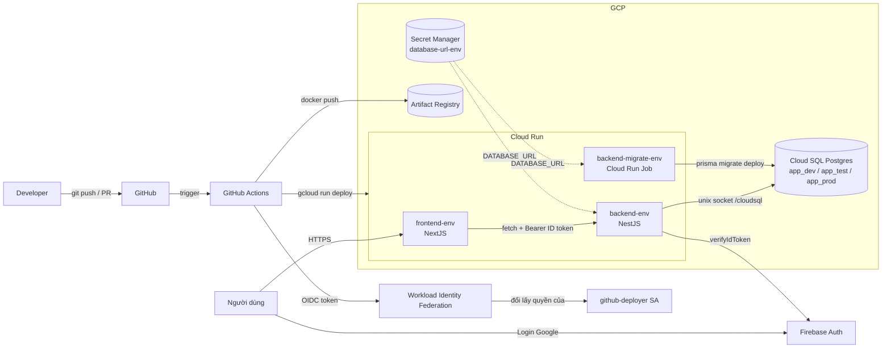
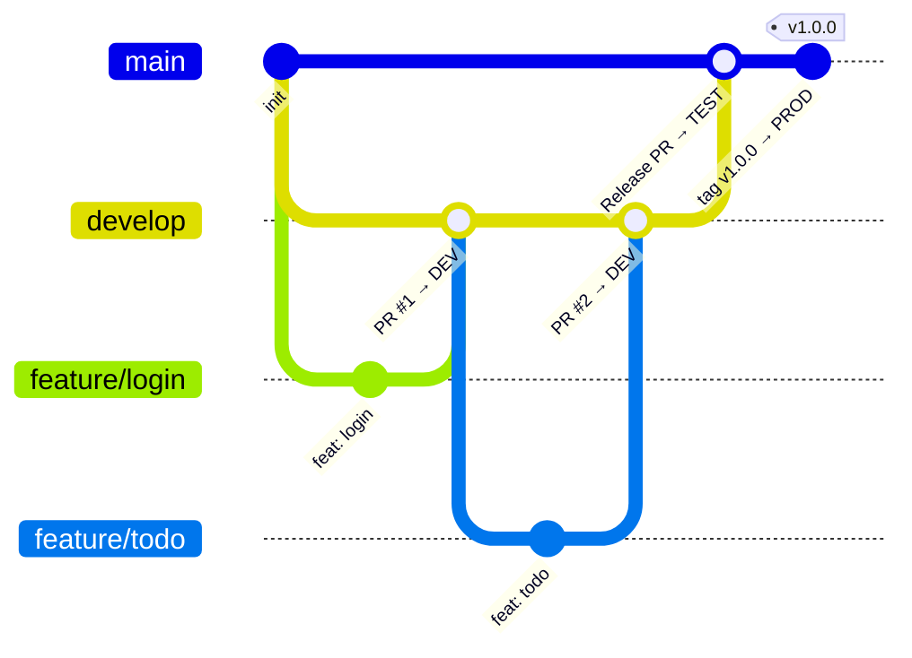
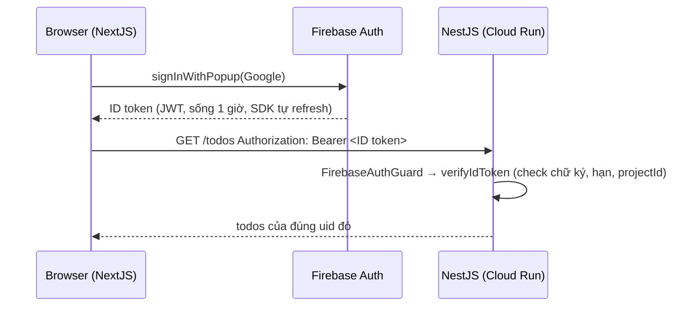

# 01 — Kiến trúc & luồng tổng thể (Ngày 1, sáng)

## 1. Bức tranh lớn

**Đọc sơ đồ:** GitHub Actions không giữ mật khẩu/key GCP nào. Nó xin GitHub một *OIDC token* chứng minh "tôi là workflow của repo X", GCP kiểm tra rồi cho mượn quyền của service account `github-deployer`. Đây là cách làm chuẩn hiện nay (thay cho file JSON key).

## 2. Hai service account — hiểu sai cái này là lỗi quyền liên tục

| SA | Ai dùng | Cần quyền gì | Vì sao |
|---|---|---|---|
| `github-deployer` | GitHub Actions lúc **deploy** | `run.admin`, `artifactregistry.writer`, `iam.serviceAccountUser` trên runtime SA | Đẩy image, tạo/sửa service, "gắn" runtime SA vào service |
| `cicd-runtime` | Container lúc **chạy** | `cloudsql.client`, `secretmanager.secretAccessor` | Kết nối DB, đọc secret |

Nguyên tắc **least privilege**: deployer không cần đọc DB; runtime không cần deploy.

## 3. Luồng 3 môi trường (branching strategy)

| Sự kiện | Workflow | Môi trường | Cổng chặn |
|---|---|---|---|
| Mở PR vào `develop`/`main` | `ci.yml` | — | CI phải xanh mới được merge (branch protection) |
| Merge vào `develop` | `deploy-dev.yml` | **dev** | Tự động |
| Merge `develop` → `main` | `deploy-test.yml` | **test** (QA/UAT) | Tự động |
| Tạo tag `v1.2.3` trên `main` | `deploy-prod.yml` | **prod** | Tag phải nằm trên main + **người duyệt bấm Approve** |

> Công ty bạn có thể khác (vd `release/*` → test, hoặc `workflow_dispatch` chọn env). Ý tưởng cốt lõi giống nhau: **càng gần prod, càng nhiều cổng chặn.**

## 4. Mỗi môi trường khác nhau ở đâu?

| | dev | test | prod |
|---|---|---|---|
| Cloud Run service | `backend-dev`, `frontend-dev` | `*-test` | `*-prod` |
| Database | `app_dev` | `app_test` | `app_prod` |
| Secret | `database-url-dev` | `database-url-test` | `database-url-prod` |
| Firebase project | thường dùng chung dev/test | | **project riêng** |
| `MIN_INSTANCES` | 0 (rẻ, có cold start) | 0 | ≥1 (không cold start) |
| Ai deploy | tự động | tự động | phải duyệt |

**Cùng code, khác cấu hình** — cấu hình nằm ở *GitHub Environment variables* + *Secret Manager*, không nằm trong code.

## 5. Luồng đăng nhập Firebase

Backend **không lưu session**, mỗi request tự mang token → stateless → Cloud Run scale ngang thoải mái.

## 6. Một lần deploy diễn ra thế nào (`_deploy.yml`)

1. Checkout code
2. Auth GCP bằng WIF
3. **Build BE image** tag = commit SHA (nếu SHA đã có image → *tái sử dụng*: build once, deploy many)
4. **Migration DB** bằng Cloud Run Job `prisma migrate deploy` — chạy *trước* code mới
5. **Deploy BE** → lấy URL
6. **Build FE image** với `NEXT_PUBLIC_API_URL = URL BE` (phải build riêng mỗi env — xem doc 04)
7. **Deploy FE**
8. **Smoke test**: `/health` trả đúng `version == SHA` chưa?

## Tự kiểm tra
- [ ] Vì sao GitHub Actions không cần JSON key mà vẫn deploy được lên GCP?
- [ ] Container BE lấy `DATABASE_URL` từ đâu? Ai được quyền đọc nó?
- [ ] Tại sao migration chạy trước deploy code chứ không phải sau?
- [ ] Muốn lên prod phải qua mấy cổng chặn? Kể tên.
